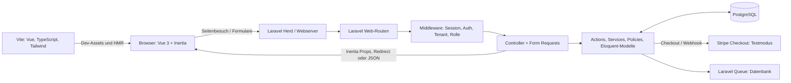

# Architektur

LazyTown ist ein Laravel-Monolith mit Vue-Oberfläche. Laravel verarbeitet Routing, Authentifizierung, Berechtigungen und Datenzugriff; Inertia liefert Seitenkomponenten und Props an Vue, statt eine eigenständige REST-API als primäre Schnittstelle bereitzustellen.

## Architektur in Kürze

- **Backend:** Laravel 13, PHP ab 8.3, Eloquent und PostgreSQL. Controller, Form Requests, Policies, Middleware, Actions und Services liegen in `app/`.
- **Frontend:** Vue 3 und TypeScript. `resources/js/app.ts` initialisiert Inertia; Seiten werden in `resources/js/pages/` organisiert.
- **Kommunikation:** Benannte Laravel-Web-Routen und Wayfinder-Typen für Frontend-Aufrufe. Die meisten Requests liefern Inertia-Seiten oder Redirects. Suche und CSV-Vorschau liefern JSON; die Profildaten werden als JSON-Datei exportiert.
- **Mandanten:** Vereine sind `Tenant`-Datensätze in derselben Datenbank. Tenant-spezifische Daten referenzieren `tenant_id`; `ResolveTenantFromSubdomain` löst eine Vereins-Subdomain auf.
- **Integrationen:** Stripe-Test-Checkout für Zahlungen; Laravel Notification Database/Mail-Kanäle; Laravel Scout mit Database-Engine als Suchstandard.

## Komponentendiagramm



Das Diagramm zeigt die tatsächlich eingesetzten Hauptkomponenten. Ein separater API-Service, Repository-Layer oder Modulcontainer ist nicht vorhanden. Die Queue ist in `.env.example` auf den Datenbanktreiber eingestellt; die Anwendungskonfiguration richtet nicht selbst einen dauerhaften Worker ein.

## Request-Sequenz: Spielplan anzeigen

```mermaid
sequenceDiagram
    actor User as Benutzer
    participant Browser as Vue/Inertia
    participant Laravel as Laravel Router
    participant Middleware as Web-Middleware
    participant Controller as MatchPlanController
    participant Models as Eloquent
    participant DB as PostgreSQL

    User->>Browser: Öffnet /spielplan
    Browser->>Laravel: GET /spielplan (Session-Cookie)
    Laravel->>Middleware: web, auth, club.access
    Middleware->>Middleware: Tenant aus Host auflösen; Verein-Zugriff prüfen
    Middleware->>Controller: Request an show()
    Controller->>Models: Vereine, Saisons und Spiele laden
    Models->>DB: tenant_id/team_id-gefilterte Abfragen
    DB-->>Models: Datensätze
    Models-->>Controller: Collections
    Controller-->>Browser: Inertia-Seite Spielplan + Props
    Browser-->>User: Vue rendert die Seite
```

Die konkrete Autorisierung zum Bearbeiten erfolgt zusätzlich zu den Route-Middleware-Prüfungen in den Form Requests beziehungsweise über Team-Policies. Für Änderungen ist daher nicht allein die Sichtbarkeit eines Buttons maßgeblich.

## Fachliche Gruppierung und Abhängigkeiten

Die Begriffe **Teams**, **Pläne**, **Suche**, **Einstellungen**, **Benachrichtigungen**, **Authentifizierung** und **Startseite** beschreiben fachliche Zuständigkeiten. Sie sind keine getrennt installierbaren Module.

| Fachbereich | Verantwortung | Wichtige Abhängigkeiten |
|---|---|---|
| Authentifizierung | Fortify-Flows, Passkeys, 2FA, Onboarding | User, Tenant/Team bei Registrierung |
| Teams und Vereinsverwaltung | Teams, Mitgliedschaften, Einladungen, Rollen, Zahlungen | Auth, Tenant, PermissionSynchronizer, Notifications, Stripe |
| Pläne | Spiele, Trainings, Hallen, CSV-Parsing | Tenant/Team, Form Requests, Notification-Service |
| Suche | Vorschläge nach Kontext | Search-Provider, Scout-Modelle, Tenant und aktuelles Team |
| Benachrichtigungen | Datenbank-Mitteilungen und Einstellungen | User, Team-/Plan-Aktionen |
| Einstellungen | Profil, Sicherheit, Datenschutzexport und Präferenzen | User, Fortify, Benachrichtigungen |
| Startseite | Persönlicher Überblick und offene Vereinsvorgänge | User, Teams, Trainings, Spiele, Nachrichten und Einladungen |

Die Kopplung erfolgt hauptsächlich über Konstruktor-Injection von Actions und Services, Eloquent-Beziehungen sowie Inertia-Props. Eine eigene Event-/Listener- oder Repository-Schicht ist im Anwendungscode nicht angelegt. Für Dateien, Klassen und Routen siehe [Projektstruktur](./project-structure.md), [Backend](./backend.md) und die [Fachbereichsübersicht](./modules/README.md).

