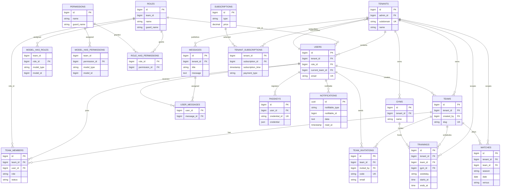

# Datenbank und Migrationen

Die lokale Beispielkonfiguration und CI verwenden PostgreSQL 16. Die Anwendung verwendet eine gemeinsame Datenbank für alle Tenants; tenant-spezifische Datensätze werden über Fremdschlüssel und `tenant_id` getrennt.

## ER-Diagramm

`NOTIFICATIONS` is polymorphic (`notifiable_type`, `notifiable_id`); `SESSIONS` contains an indexed but not constrained `user_id`. The diagram shows the primary application relationships, not every Laravel infrastructure column.

## Fachliche Tabellen

| Tabelle | Spalten (zusätzlich zu Primärschlüssel/Zeitstempeln wie angegeben) | Beziehungen / Hinweise |
|---|---|---|
| `users` | `public_id`, `tenant_id`, `role_id`, `current_team_id`, `name`, `first_name`, `last_name`, `birth_date`, `birth_place`, `nationality`, `sex`, `address`, `city`, `postcode`, `phone`, `email`, `email_verified_at`, `password`, `roles` (JSON), `active_role`, `two_factor_secret`, `two_factor_recovery_codes`, `two_factor_confirmed_at`, `notification_settings` (JSON), `must_change_password`, `remember_token`, `created_at`, `updated_at` | Tenant, optional Paketrolle, aktuelles Team; E-Mail und `public_id` eindeutig |
| `tenants` | `admin_id`, `subdomain`, `name`, Zeitstempel | `admin_id` → `users`; eindeutige Subdomain |
| `teams` | `tenant_id`, `created_by`, `name`, `slug`, `logo_path`, `is_personal`, `payment_status`, `payment_reference`, `payment_paid_at`, Zeitstempel, `deleted_at` | Tenant, Ersteller; eindeutiger Slug, Soft Deletes |
| `team_members` | `team_id`, `user_id`, `role`, `status`, `tenant_id`, `role_id`, Zeitstempel | Pivot/`Membership`; eindeutige Kombination Team/User |
| `team_invitations` | `code`, `team_id`, `email`, `role`, `invited_by`, `expires_at`, `accepted_at`, Zeitstempel | Team und einladender User; eindeutiger Code |
| `matches` | `tenant_id`, `team_id`, `season`, `date`, `versus`, `at_home`, `city`, Zeitstempel | Modell `ClubMatch`; Tenant und Team |
| `trainings` | `tenant_id`, `team_id`, `gym_id`, `weekday`, `starts_at`, `ends_at`, Zeitstempel | Tenant und Team; optionale Halle |
| `gyms` | `tenant_id`, `name`, Zeitstempel | `tenant_id` ist nullable: tenant-eigene oder gemeinsame Halle |
| `messages` | `tenant_id`, `title`, `message`, Zeitstempel | Gehört zum Tenant |
| `user_messages` | `user_id`, `message_id` | Pivot mit zusammengesetztem Primärschlüssel |
| `subscriptions` | `type`, `price`, Zeitstempel | Subscription-Angebot |
| `tenant_subscriptions` | `tenant_id`, `subscription_id`, `subscription_time`, `payment_type` | Zusammengesetzter Primärschlüssel; `payment_type` nullable |
| `passkeys` | `user_id`, `name`, eindeutige `credential_id`, `credential` (JSON), `last_used_at`, Zeitstempel | Zugehörig zu User; Löschung kaskadiert |
| `notifications` | UUID `id`, `type`, `notifiable_type`, `notifiable_id`, `data`, `read_at`, Zeitstempel | Laravel Database-Notifications, polymorpher Empfänger |

### Berechtigungs- und Infrastruktur-Tabellen

| Tabelle | Spalten | Zweck |
|---|---|---|
| `roles` | `id`, `team_id` (nullable), `name`, `guard_name`, Zeitstempel | Spatie-Rollen; Team-Scope ist aktiviert |
| `permissions` | `id`, `name`, `guard_name`, Zeitstempel | Spatie-Berechtigungen |
| `model_has_roles` | `team_id`, `role_id`, `model_type`, `model_id` | Rollen polymorphen Modellen im Team zuordnen |
| `model_has_permissions` | `team_id`, `permission_id`, `model_type`, `model_id` | Berechtigungen polymorphen Modellen im Team zuordnen |
| `role_has_permissions` | `permission_id`, `role_id` | Berechtigungen an Rollen binden |
| `password_reset_tokens` | `email` (Primärschlüssel), `token`, `created_at` | Passwortwiederherstellung |
| `sessions` | `id`, `user_id`, `ip_address`, `user_agent`, `payload`, `last_activity` | Web-Sessions; DB-Sessiontreiber in `.env.example` |
| `cache` | `key`, `value`, `expiration` | Datenbank-Cache |
| `cache_locks` | `key`, `owner`, `expiration` | Datenbank-Cache-Sperren |
| `jobs` | `id`, `queue`, `payload`, `attempts`, `reserved_at`, `available_at`, `created_at` | Datenbankqueue |
| `job_batches` | `id`, `name`, `total_jobs`, `pending_jobs`, `failed_jobs`, `failed_job_ids`, `options`, `cancelled_at`, `created_at`, `finished_at` | Queue-Batches |
| `failed_jobs` | `id`, `uuid`, `connection`, `queue`, `payload`, `exception`, `failed_at` | Fehlgeschlagene Jobs |

Laravel verwaltet zusätzlich die Migrationstabelle `migrations`; sie wird durch den Framework-Migrationsmechanismus angelegt.

## Migrationen

Migrationen werden chronologisch ausgeführt. Nachfolgende Änderungen ergänzen frühere Tabellen; die oben stehenden Spalten zeigen den aktuellen Schema-Zustand nach allen Dateien.

| Migration | Inhalt |
|---|---|
| [0001_01_01_000000_create_users_table.php](../database/migrations/0001_01_01_000000_create_users_table.php) | Users, Passwort-Reset-Tokens und Sessions |
| [0001_01_01_000001_create_cache_table.php](../database/migrations/0001_01_01_000001_create_cache_table.php) | Cache und Cache Locks |
| [0001_01_01_000002_create_jobs_table.php](../database/migrations/0001_01_01_000002_create_jobs_table.php) | Jobs, Batches und Failed Jobs |
| [2024_01_01_000000_create_passkeys_table.php](../database/migrations/2024_01_01_000000_create_passkeys_table.php) | Passkeys |
| [2025_08_14_170933_add_two_factor_columns_to_users_table.php](../database/migrations/2025_08_14_170933_add_two_factor_columns_to_users_table.php) | 2FA-Spalten für Users |
| [2026_01_27_000001_create_teams_table.php](../database/migrations/2026_01_27_000001_create_teams_table.php) | Teams, Mitgliedschaften und Einladungen |
| [2026_01_27_000002_add_current_team_id_to_users_table.php](../database/migrations/2026_01_27_000002_add_current_team_id_to_users_table.php) | Aktuelles Team des Users |
| [2026_09_02_125705_add_profile_details_to_users_table.php](../database/migrations/2026_09_02_125705_add_profile_details_to_users_table.php) | Profilfelder |
| [2026_09_03_000001_add_roles_to_users_table.php](../database/migrations/2026_09_03_000001_add_roles_to_users_table.php) | Globale User-Rollen als JSON und aktive Rolle |
| [2026_09_03_000002_add_payment_status_to_teams_table.php](../database/migrations/2026_09_03_000002_add_payment_status_to_teams_table.php) | Team-Zahlungsstatus und Zahlungsreferenz |
| [2026_09_03_000003_add_created_by_to_teams_table.php](../database/migrations/2026_09_03_000003_add_created_by_to_teams_table.php) | Team-Ersteller |
| [2026_09_03_000004_add_status_to_team_members_table.php](../database/migrations/2026_09_03_000004_add_status_to_team_members_table.php) | Mitgliedsstatus |
| [2026_09_03_115244_add_public_id_to_users_table.php](../database/migrations/2026_09_03_115244_add_public_id_to_users_table.php) | Eindeutige öffentliche User-ID |
| [2026_09_10_135318_create_permission_tables.php](../database/migrations/2026_09_10_135318_create_permission_tables.php) | Spatie-Rollen-/Permission-Tabellen |
| [2026_09_30_083759_create_tenant_domain_tables.php](../database/migrations/2026_09_30_083759_create_tenant_domain_tables.php) | Tenant, tenantbezogene FKs, Spiele, Trainings, Hallen, Nachrichten und Subscriptions |
| [2026_09_30_184539_make_tenant_subscription_payment_type_nullable.php](../database/migrations/2026_09_30_184539_make_tenant_subscription_payment_type_nullable.php) | Zahlungsart nullable |
| [2026_10_08_075901_add_notification_settings_to_users_table.php](../database/migrations/2026_10_08_075901_add_notification_settings_to_users_table.php) | Notification-Einstellungen als JSON |
| [2026_10_08_085804_create_notifications_table.php](../database/migrations/2026_10_08_085804_create_notifications_table.php) | Laravel-Notifications |
| [2026_10_10_064512_add_must_change_password_to_users_table.php](../database/migrations/2026_10_10_064512_add_must_change_password_to_users_table.php) | Erzwingt Passwortwechsel beim initialen Zugang |
| [2026_10_12_133851_add_tenant_id_to_gyms_table.php](../database/migrations/2026_10_12_133851_add_tenant_id_to_gyms_table.php) | Optionale Tenant-Zuordnung der Hallen |
| [2026_10_14_095043_add_logo_path_to_teams_table.php](../database/migrations/2026_10_14_095043_add_logo_path_to_teams_table.php) | Logo-Pfad für Teams |

## Seeders und Factories

[DatabaseSeeder.php](../database/seeders/DatabaseSeeder.php) führt `TeamPermissionSeeder` aus und erstellt einen einfachen Testbenutzer. [TeamPermissionSeeder.php](../database/seeders/TeamPermissionSeeder.php) synchronisiert Teamrollen und Berechtigungen; [DemoAccountsSeeder.php](../database/seeders/DemoAccountsSeeder.php) legt nur in `local`/`testing` wiederholbar Demo-Tenants, Teams, Mitglieder und Subscriptions an. Factories liegen unter [database/factories](../database/factories).
